# Shifra (شَفرة) — Multi-Tenant Smart Restaurant POS, KDS & QR Menu Platform

[](https://openjdk.org/)
[](https://spring.io/projects/spring-boot)
[](https://react.dev/)
[](https://flutter.dev/)
[](https://www.docker.com/)

**Shifra (شَفرة)** is an end-to-end, multi-tenant SaaS restaurant management ecosystem built to synchronize front-of-house, kitchen, cashier, and customer ordering workflows in **real time**.

From a guest scanning a table QR code to the kitchen preparing the ticket, the waiter serving the table via mobile, and the cashier printing a tax-compliant thermal receipt — every action propagates across screens in milliseconds via **WebSockets (STOMP/SockJS)**.

---

## Architecture & Tech Stack

### 1. Multi-Module Hexagonal / Clean Backend (`Java 17` + `Spring Boot 3.3`)
Structured into four strictly decoupled Maven modules following **Hexagonal Architecture (Ports & Adapters)**:
- **`domain`**: Pure Java business entities (`Order`, `Invoice`, `Organization`, `Branch`, `RestaurantTable`, `TableSession`, `AuditLog`), domain exceptions, and `BigDecimal` (`HALF_UP`) financial rules with zero framework dependencies.
- **`application`**: Use-case interfaces (`port.in`), outbound ports (`port.out`), commands/results, and application services (`PlaceOrderService`, `CloseBillService`, `UpdateOrderStatusService`, `ModifyPendingOrderService`, `OrderItemResolver`, etc.).
- **`infrastructure`**: Spring Data JPA + MySQL 8 persistence adapters, Redis caching/coordination support, Spring Security + stateless JWT authentication, STOMP WebSocket configuration, rate-limiting & idempotency filters, tenant isolation interceptors, and automated database backup scheduler.
- **`boot`**: Application entry point (`RestaurantApplication`) and environment-driven profiles (`application.yml`, `application-dev.yml`).

### 2. Security, RBAC & Multi-Tenancy
- **JWT & Role-Based Access Control (RBAC):** Supports platform and restaurant roles mapped cleanly across Owner/Manager (`ORG_ADMIN` / `isOwner`), Cashier (`CASHIER`), Chef / Kitchen Staff (`KITCHEN_STAFF`), Waiter (`WAITER`), Platform Admin (`SUPER_ADMIN`), and Guest (`CUSTOMER`).
- **Strict Tenant & Branch Isolation (Anti-IDOR):** Centralized `TenantIsolationInterceptor` + `TenantAccessGuard` on HTTP endpoints, plus `WebSocketAuthChannelInterceptor` verifying JWT and branch/organization ownership before subscribing to `/topic/branch/{branchId}/{kds|pos|waiter}`.
- **Abuse & Brute-Force Protection:** Per-table + IP sliding-window rate limiting on public QR ordering (`/api/public/orders`) and automatic 15-minute IP lockout after 5 consecutive failed `/api/auth/login` attempts.
- **Concurrency & Idempotency:** Branch-level transaction locking + DB unique constraints prevent order/invoice number collisions and duplicate table sessions; `Idempotency-Key` header prevents duplicate orders on flaky restaurant Wi-Fi.
- **Immutable Financial Audit Ledger:** Append-only `audit_logs` table (`@Immutable` + `@PreUpdate`/`@PreRemove` guards) tracking bill closures, discounts, order cancellations, and menu price updates.

### 3. Web Dashboard & POS Frontend (`frontend/`)
- **Stack:** React, TypeScript/JSX, Vite, Tailwind CSS, Recharts, Axios, `@stomp/stompjs`, `sockjs-client`, and offline local QR code generation (`qrcode`).
- **Interfaces:** Super Admin SaaS console, Organization/Menu/Table QR studio, Staff & Branch management, Cashier POS, Kitchen Display System (KDS), Pickup TV Screen, Analytics Dashboard, and Customer Public QR Menu.

### 4. Mobile Waiter App (`waiter_app/`)
- **Stack:** Flutter (`http`, `stomp_dart_client`, `shared_preferences`, `qr_flutter`, `intl`).
- **Capabilities:** Real-time branch table grid, order creation & pre-prep editing, ready-to-serve alerts, multi-branch switching, password management, local menu/table caching for weak Wi-Fi resilience, and `Idempotency-Key` checkout protection.

### 5. DevOps & Deployment
- **Containerization:** Multi-stage `Dockerfile` for backend and Nginx SPA `frontend`, orchestrated via `docker-compose.yml` alongside MySQL 8 and an automated daily compressed `db-backup` container.
- **CI/CD:** GitHub Actions pipeline ready for automated build & test verification.

---

## Key Features

- **Multi-Branch & SaaS Subscription Tiers:** Manage single restaurants or multi-branch chains (`TRIAL`, `BASIC`, `PRO`, `ENTERPRISE` limits) with independent working hours, working days, tax rates, and service charges per branch.
- **Smart Customer QR Menu:** Table-bound QR ordering supporting item **Variants** (sizes), **Addons**, kitchen notes, real-time 86'd availability, **Call Waiter / Request Bill** alerts, and live multi-order status tracking.
- **Cashier POS & Tax-Compliant Billing:** Live table occupancy map, Dine-In / Takeaway / Delivery order creation, kitchen-aware bill closure (blocks closing while items are `PREPARING`), proportional discounts, **Base64 TLV Tax QR Code** generation, and 80mm thermal receipt printing.
- **Real-Time KDS & Pickup TV Screen:** Color-coded kitchen ticket columns (`PENDING`, `PREPARING`, `READY`) with audio chimes, elapsed prep timers, instant item out-of-stock toggling, and a live customer-facing TV pickup board.
- **Flutter Waiter App:** Live synchronization with POS & KDS, instant push-style WebSocket snackbar alerts for ready dishes and table calls, and resilient offline fallback views.
- **Sales Analytics & Audit Reports:** Daily revenue, average ticket size, top-selling items, order source breakdown (`QR`, `POS`, `Waiter`), 7-day revenue charts, and paginated order/invoice/audit history.

---

## Screenshots

### Management & Configuration
| Menu, Categories & Variants Management | Tables & Instant QR Code Generator |
| :---: | :---: |
| 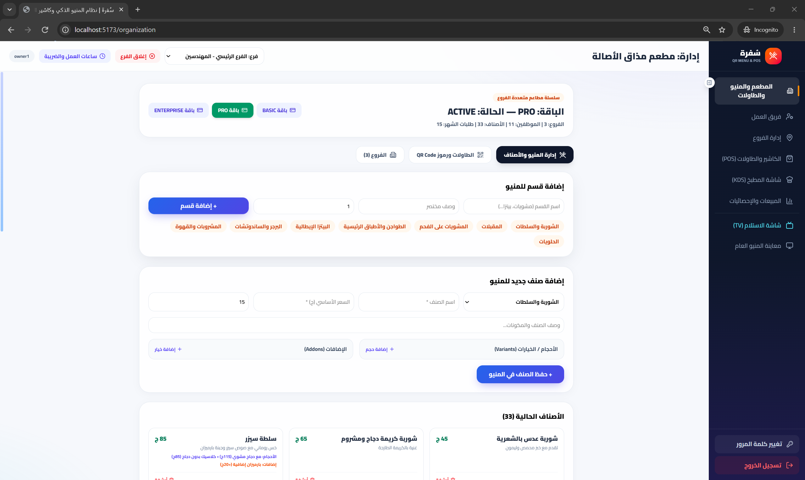 | 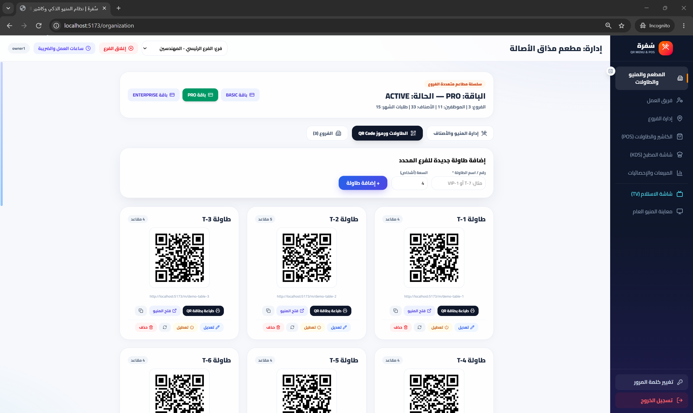 |

| Multi-Branch Staff & Role-Based Access Management | Branches, Working Hours & Tax Configuration |
| :---: | :---: |
| 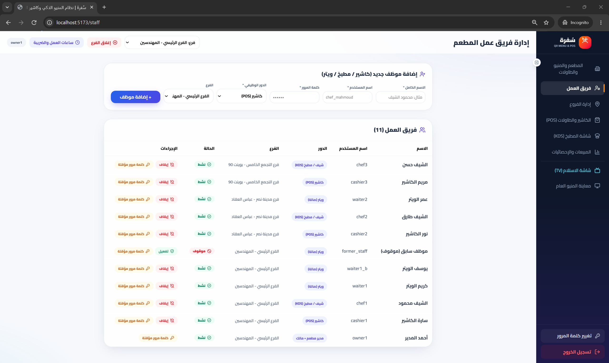 | 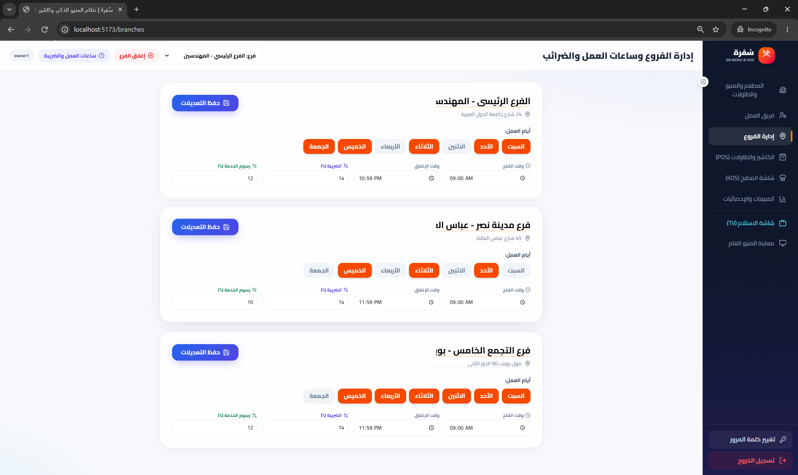 |

### Customer Menu, POS, KDS, Pickup TV & Analytics
| Customer Digital QR Menu | Cashier POS & Real-Time Table Status Map |
| :---: | :---: |
| 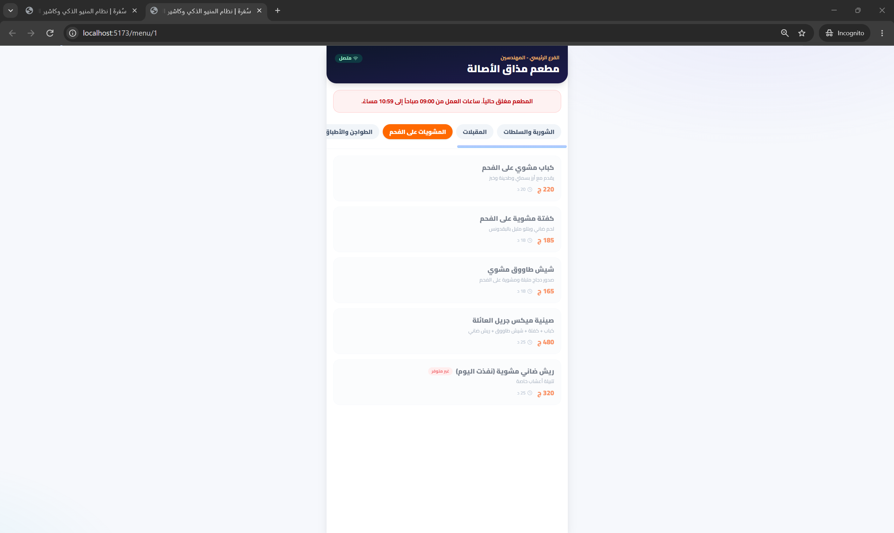 | 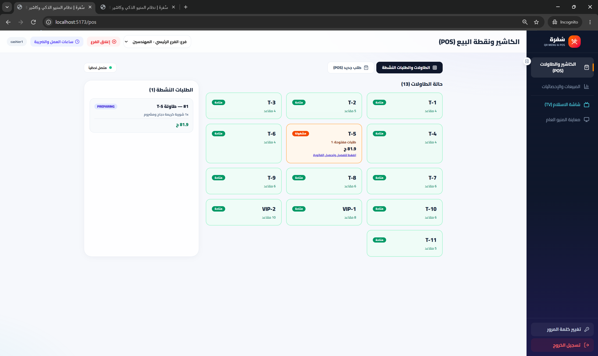 |

| POS New Order & Item Customization | Real-Time Kitchen Display System (KDS) |
| :---: | :---: |
| 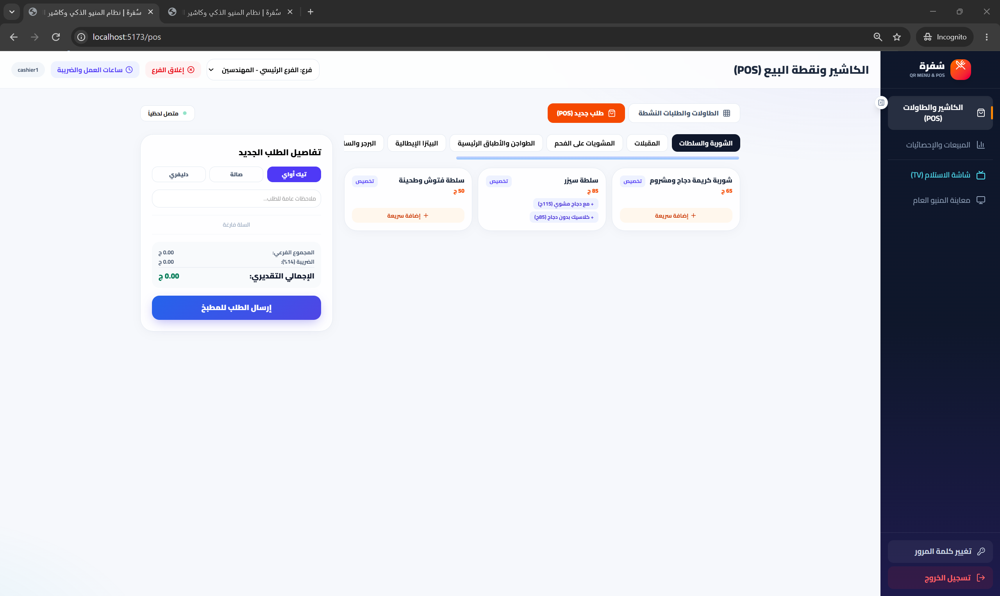 | 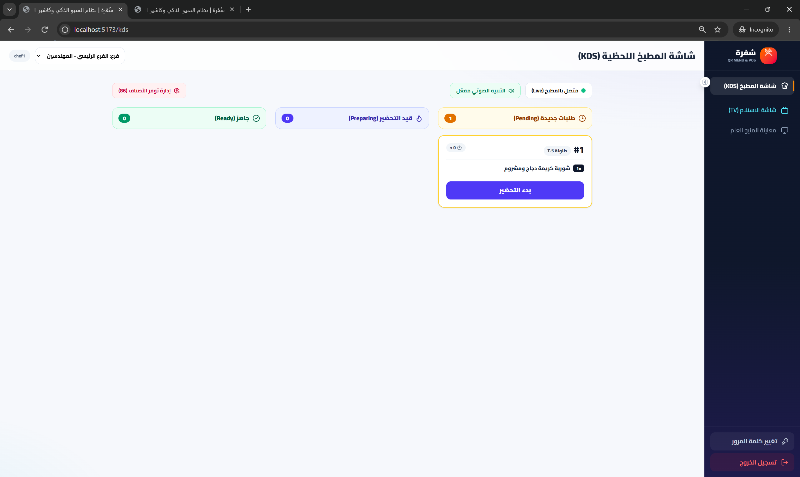 |

| Customer Order Pickup TV Screen | Sales Analytics & Order Source Breakdown |
| :---: | :---: |
| 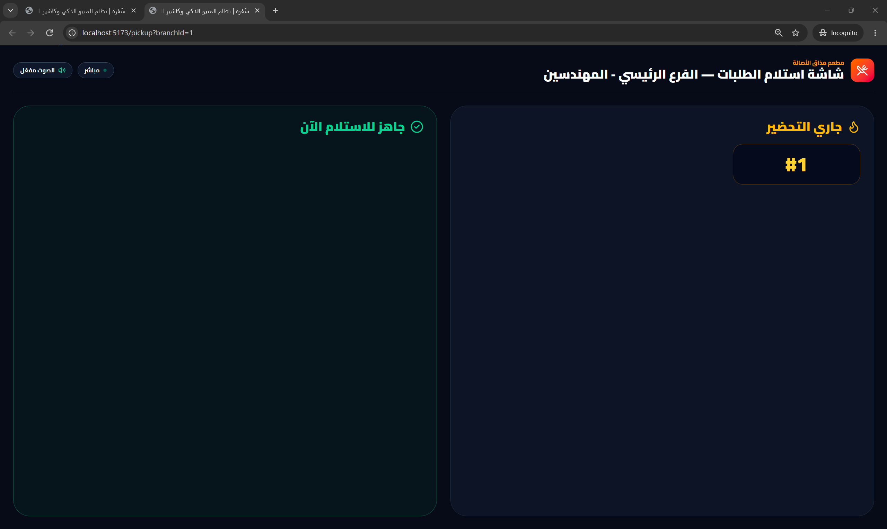 | 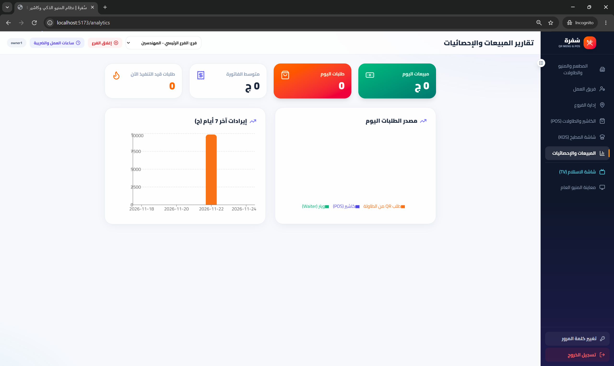 |

### Flutter Waiter Mobile App (`waiter_app`)
| Live Branch Tables | Table Order Creation | Variants, Addons & Kitchen Notes |
| :---: | :---: | :---: |
| 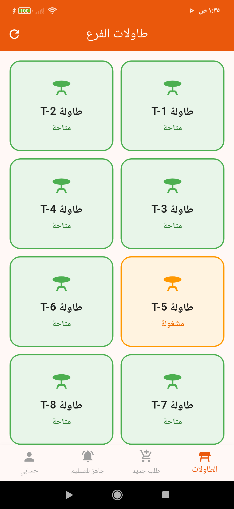 | 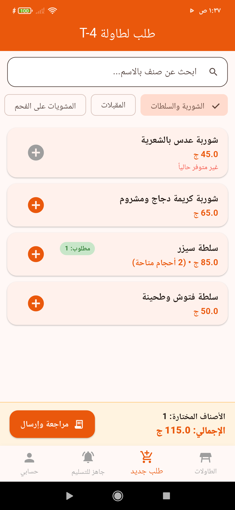 | 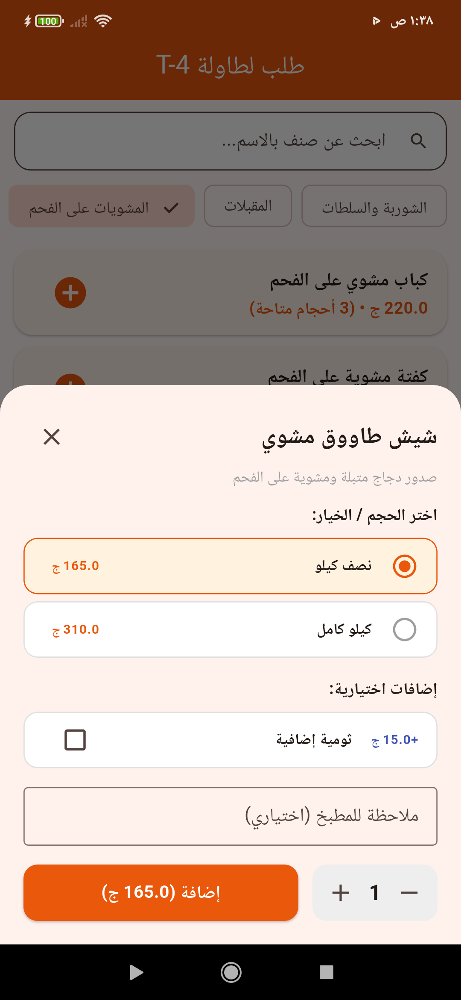 |

---

## Project Structure

```text
restaurant-platform/
├── domain/                  # Pure Java domain models, business rules & exceptions
├── application/             # Use cases, commands, results & outbound ports
├── infrastructure/          # JPA entities/repos, Security/JWT, WebSockets, Filters, Backup
├── boot/                    # Spring Boot main class & application YAML configs
├── frontend/                # React + Vite + Tailwind web app + Nginx Dockerfile
├── waiter_app/              # Flutter mobile app for waiters & floor staff
├── docs/screenshots/        # UI & mobile screenshots
├── Dockerfile               # Multi-stage backend build
├── docker-compose.yml       # MySQL, daily db-backup, backend & Nginx frontend
└── .env.example             # Environment variables template
```

---

## Getting Started

### Prerequisites
- **Docker & Docker Compose** (recommended for full-stack run), OR:
- **Java 17** & **Maven 3.9+**
- **MySQL 8.0**
- **Node.js 20+**
- **Flutter SDK 3.x+** (for mobile app)

### 1. Run with Docker Compose (Production-Ready Setup)
1. Clone the repository and create your `.env` file from the template:
   ```bash
   git clone https://github.com/ahmedshawky7/shifra-restaurant-platform.git
   cd shifra-restaurant-platform
   cp .env.example .env
   ```
2. Edit `.env` with strong values for `MYSQL_ROOT_PASSWORD`, `JWT_SECRET` (Base64 >= 32 bytes), and `APP_SUPERADMIN_PASSWORD` (>= 8 chars in `prod`).
3. Build and launch all services:
   ```bash
   docker compose up -d --build
   ```
4. Access the web portal at `http://localhost` (API on `http://localhost:8080`).

### 2. Run Locally in Development Mode (`dev` Profile)
The `dev` profile automatically seeds a full demo restaurant (**2 organizations, 3 branches, 26 tables, 35+ menu items, staff accounts, live orders, and 7-day analytics history**):

- **Backend:**
  ```bash
  mvn spring-boot:run -pl boot -Dspring-boot.run.profiles=dev
  ```
- **Frontend:**
  ```bash
  cd frontend
  npm install
  npm run dev
  ```
- **Flutter Waiter App:**
  ```bash
  cd waiter_app
  flutter pub get
  # Android emulator uses 10.0.2.2:8080; for physical devices pass your LAN IP:
  flutter run --dart-define=API_HOST=192.168.1.107:8080
  ```

---

## Demo Credentials & Quick URLs (`dev` Profile)

| Role | Username | Password | Target Screen |
| :--- | :--- | :--- | :--- |
| **Platform Super Admin** | `superadmin` | `123456` | `/super-admin` |
| **Organization Owner / Manager** | `owner1` | `123456` | `/organization` |
| **Branch Cashier** | `cashier1` | `123456` | `/pos` |
| **Kitchen Chef** | `chef1` | `123456` | `/kds` |
| **Floor Waiter (Mobile App)** | `waiter1` | `123456` | Flutter App |

- **Public Customer Table QR Menu:** `http://localhost:5173/m/demo-table-1`
- **Public Pickup TV Display:** `http://localhost:5173/pickup?branchId=1`

---

## Testing & Verification

```bash
# Backend unit & architecture tests
mvn clean test

# Frontend production build & lint
cd frontend && npm run lint && npm run build

# Flutter static analysis & widget tests
cd waiter_app && flutter analyze && flutter test
```
